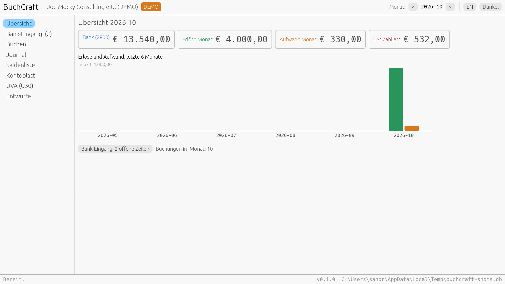
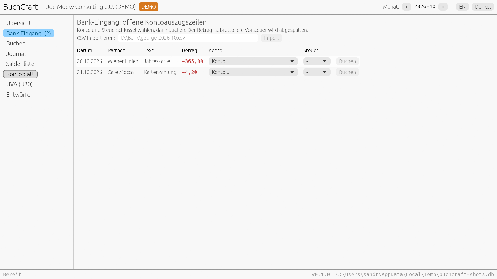
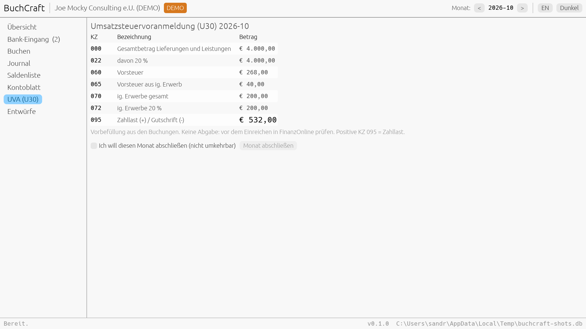

# buchcraft

Austrian double-entry bookkeeping as a local-first craft app. Pure Rust,
SQLite (WAL), one binary that is both a CLI and an MCP server. Part of the
back-office craft suite (plan: `mcp-central-docs/projects/craft-fleet-expansion/BACKOFFICE_CRAFT_SUITE.md`).

Replaces the bookkeeping part of BMD NTCS, RZL, DATEV or sevDesk for a small
Austrian business. Does **not** file anything with FinanzOnline, is not a
Registrierkasse (RKSV) and does no payroll.

## What is real in v0.1.0

| Feature | State |
|---|---|
| EKR chart (seed + own accounts) | Real. Seed numbers are a starting point; check them against your Steuerberater's chart. |
| Balanced entries, integer cents | Real. Sum of lines must be exactly zero. |
| VAT keys U20/U10/U13/V20/V10/V13/IGE20 | Real. You book NET lines with a key; the engine adds the tax line. You cannot book VAT twice. |
| Immutability + Storno | Real. SQLite triggers block UPDATE/DELETE on booked rows; corrections are linked Storno entries. |
| Month close | Real. Bookings dated in a closed month are refused. |
| Saldenliste, Kontoblatt, journal | Real. |
| U30 pre-fill (KZ 000/006/022/029/060/065/070/072/095) | Real computation from booked entries. Not a filing. |
| Bank CSV import | Real parser with German/English header aliases, dedup on re-import. **Not yet verified against a real George export.** |
| Drafts from other craft apps (bus) | Real for `asset.depreciation_due`. Drafts book only on approval. |
| Demo company | Labelled demo (`demo: true` everywhere), only on an empty ledger. |
| Desktop app (egui) | Real: overview with KPIs and 6-month chart, bank inbox (pick account + tax key, book), gross booking form with live net/tax preview, journal with Storno, Saldenliste, Kontoblatt, U30 with month close, drafts. De/En, light/dark. No egui_kittest golden snapshots yet. |

## Desktop app

```powershell
.\start.bat                       # builds and opens the window
buchcraft-app --db .\demo.db --lang de --view bank
buchcraft-app --smoke             # headless status check, no window
buchcraft-app --view u30 --screenshot u30.png   # render one PNG and exit
```





## Quick start

```powershell
cargo build --release
$b = ".\target\release\buchcraft.exe"   # or D:\Dev\cargo-target\release
& $b --db .\demo.db demo-seed
& $b --db .\demo.db u30 2026-10
& $b --db .\demo.db balance --from 01.10.2026 --to 31.10.2026
& $b --db .\demo.db bank unmatched
& $b --db .\demo.db accounts add 7300 "Reisekosten" --kind expense --tax-key V10
& $b --db .\demo.db bank book 3 --account 7300 --tax-key V10
```

Add `--json` to any verb for machine output. Default database:
`$env:BUCHCRAFT_DB` or `%LOCALAPPDATA%\buchcraft\buchcraft.db`.

## Who uses it, for what

| User | Prompt to their agent | Tools that run |
|---|---|---|
| Sole trader (e.U.) | "Import my George export and suggest accounts for the unbooked lines" | `buch_bank_import`, `buch_bank_unmatched`, `buch_bank_book` |
| Small GmbH office | "What is our VAT payable for October?" | `buch_u30` |
| Bookkeeper | "Reverse invoice AR-2026-0002, wrong amount, then rebook it" | `buch_entry_reverse`, `buch_entry_book` |
| Steuerberater hand-off | "Export the October journal as CSV for the tax adviser" | `buch_export_csv` |
| assetcraft user | "Book this year's depreciation" | `buch_inbox_drain`, `buch_drafts`, `buch_draft_approve` |

## MCP

```json
{
  "mcpServers": {
    "buchcraft": {
      "command": "D:\\Dev\\cargo-target\\release\\buchcraft.exe",
      "args": ["mcp", "--allow-path", "D:\\Books"]
    }
  }
}
```

File tools (`buch_bank_import`, `buch_export_csv`) only work inside
`--allow-path` directories in MCP mode. 22 tools; `buchcraft tools` prints the
catalog. Amounts in tool arguments are DE strings (`"1.200,00"`) or integer
`*_cents`; floats are refused.

## Gates

`just ci` = clippy `-D warnings` (unwrap/expect/panic denied), tests, fmt.
v0.1.0: 24 tests, live MCP stdio probe verified (stdout pure JSON-RPC).
